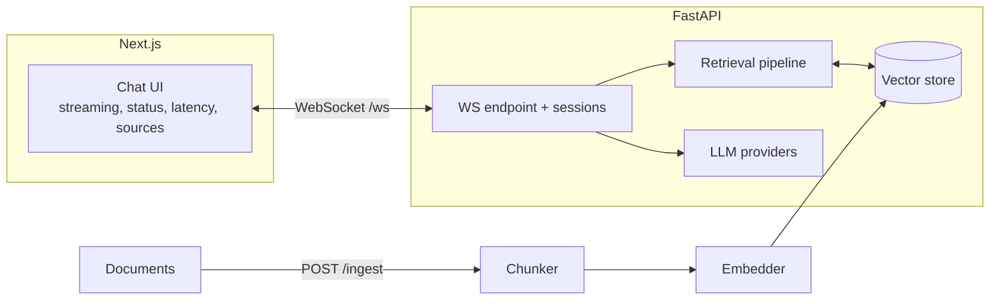

# ContextStream

Real-time RAG assistant: **FastAPI + WebSockets** backend (ingestion → chunking
→ embedding → indexing → retrieval → context assembly → streamed generation)
with a **Next.js** chat frontend (streaming tokens, connection status, latency
display, source citations, conversation history, automatic reconnect).

**Status:** code complete, NOT YET EXECUTED. Latency numbers must come from
`scripts/latency_test.py` on your machine — no sub-500ms target is claimed.

## Architecture



## Providers and fallbacks (honest matrix)

| Component | Default (no credentials) | Optional external |
|---|---|---|
| Embeddings | local deterministic hashed embedding (real, offline) | OpenAI-compatible `/embeddings` via `CONTEXTSTREAM_API_BASE` + `CONTEXTSTREAM_API_KEY` env |
| Vector store | in-memory cosine store (real) | Pinecone adapter — raises a clear error without `PINECONE_API_KEY`; interface is config-swappable |
| LLM | local **mock** (extractive from retrieved chunks, real streaming mechanics) | OpenAI-compatible streaming chat via env; never hardcoded keys |

The mock LLM composes answers **only** from retrieved chunks — it is clearly
labeled a mock, not a language model.

## Reconnect behavior

Frontend reconnects with exponential backoff (0.5s → 8s cap) and sends
`{"type": "resume", "session_id"}`; the server replays the session history.
Backend sessions live in process memory (documented limitation).

## Setup / Usage

```bash
cd contextstream
python -m venv .venv && source .venv/bin/activate
pip install -r requirements.txt

python scripts/serve.py --port 8200          # backend
python scripts/smoke_test.py                 # live E2E: ingest + WS + resume
python scripts/latency_test.py --n 20        # MEASURED latency percentiles
python -m pytest tests -q

# frontend (needs Node 18+)
cd frontend && npm install && npm run dev    # http://localhost:3000
```

WS message protocol: `connected`, `start`, `delta`, `final {answer, sources,
latency_ms}`, `resume`/`resumed`, `ping`/`pong`, `error`.

## Sample output format

```
=== CONTEXTSTREAM SMOKE TEST ===
health: {'status': 'ok', 'chunks_indexed': 0, ...}
ingest: {'chunks_indexed': 6, 'total': 6}
answer: <streamed answer>...
sources: ['zebra#0', ...] latency: <measured>ms
resumed session with 2 history entries
SMOKE OK
```

## Verification

`pytest`
(frontend build check auto-skips when `npm` is not installed)

## Known limitations

- In-memory vector store + sessions: process-lifetime only; no persistence.
- Mock LLM is extractive, not generative.
- Latency depends entirely on the machine; measured, not guaranteed.
- Pinecone adapter untested (no credentials in authoring environment).
