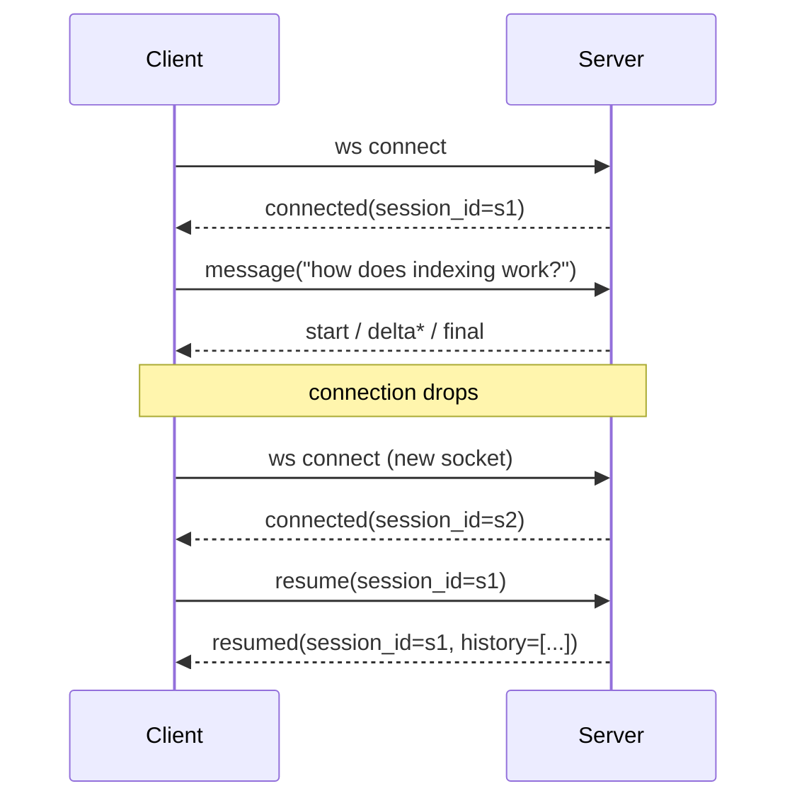

# 06 — API & WebSocket Protocol Reference

Everything a client (the bundled Next.js dashboard, `curl`, or a test harness)
needs to talk to ContextStream.

## REST endpoints

| Method | Path | Auth | Request | Response |
|---|---|---|---|---|
| GET | `/health` | — | — | `{"status", "chunks_indexed", "embedding_provider", "llm_provider", "vector_backend"}` |
| POST | `/ingest` | — | `{"documents": [{"id", "text"}]}` | `{"chunks_indexed", "total"}` |
| GET | `/sessions/{id}/history` | — | — | `{"session_id", "history": [{role, content, sources?, latency_ms?}]}` |

`POST /ingest` chunks each document (`chunk_max_chars`, `chunk_overlap`),
embeds every chunk, and upserts into the configured vector store with ids
`{doc_id}#{chunk_index}` — re-ingesting the same doc id replaces its chunks.

## WebSocket endpoint — `ws://host:port/ws`

Every connection starts with a server greeting:

```json
{"type": "connected", "session_id": "<hex>"}
```

### Client → server frames

| Frame | Purpose |
|---|---|
| `{"type": "message", "text": "..."}` | run the full RAG turn: retrieve → stream answer |
| `{"type": "resume", "session_id": "..."}` | reconnect: rebind to a prior session; server replays history |
| `{"type": "ping"}` | liveness probe |

### Server → client frames for a message turn

| Frame | Meaning |
|---|---|
| `{"type": "start", "query"}` | retrieval done; generation starting |
| `{"type": "delta", "content": "..."}` | one streamed chunk of the answer |
| `{"type": "final", "answer", "sources", "latency_ms"}` | end of turn; `sources` = `[{"id", "doc_id", "score"}]`; `latency_ms` measured server-side from turn start |
| `{"type": "error", "detail"}` | empty message, unknown type |

### Reconnect + resume sequence



Reconnect backoff on the client is exponential: 0.5s, doubling, capped at 8s.
The resume frame is sent after the *new* socket opens; the server replies with
`resumed` carrying the full session history, which the dashboard re-renders.

## Configuration (JSON + env)

Config file: `configs/app.json`, overridable per key by env:

| Env var | Overrides | Notes |
|---|---|---|
| `CONTEXTSTREAM_EMBEDDING_PROVIDER` | `embedding.provider` | `local` (default) or `external` |
| `CONTEXTSTREAM_API_BASE` | `embedding.api_base` | OpenAI-compatible base URL |
| `CONTEXTSTREAM_API_KEY` | (secret lookup) | **never** put keys in the JSON config |
| `CONTEXTSTREAM_LLM_PROVIDER` | `llm.provider` | `mock` (default) or `external` |
| `CONTEXTSTREAM_LLM_MODEL` | external model name | only used by the external provider |
| `CONTEXTSTREAM_VECTOR_BACKEND` | `vector_store.backend` | `memory` (default), `file`, or `pinecone` |
| `PINECONE_API_KEY` | (Pinecone adapter) | adapter raises a clear error without it |

Store backends: `memory` (process-lifetime), `file` (JSON at
`vector_store.path`, survives restarts, demo scale), `pinecone` (managed;
untested here — fails loudly without credentials).

## Latency measurement methodology

`scripts/latency_test.py` boots a real server subprocess, ingests a fixture,
then for each of N queries measures the wall-clock time from sending the
`message` frame to receiving the `final` frame (i.e. retrieval + streaming +
frame overhead, end to end). It reports min/median/mean/p95/max and writes
`outputs/latency.json`. The numbers are whatever the host machine produces —
the project explicitly makes **no** sub-500 ms guarantee.

## CORS

The API allows all origins in dev (`allow_origins=["*"]`) because the Next.js
dashboard runs on a different port. Restrict this in any real deployment.
